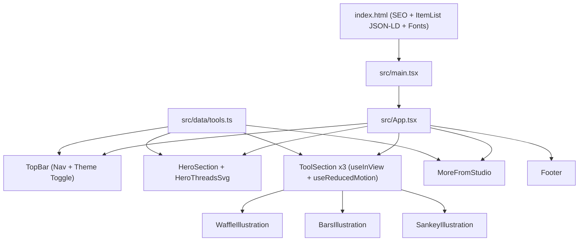

# Charts — Studio of Browser Chart Makers


A single-page **Charts** category landing page introducing three browser-based chart tools with custom pastel SVG line-art illustrations, staggered stroke draw-in animations, dark plum theme support, and SEO structured data.

## Featured Chart Tools

- **Waffle Chart Studio** — Proportional 5x5 grid charts ([Live Tool](https://nirmalya-panigrahi.github.io/Waffle-Chart-Studio/) · [Repository](https://github.com/nirmalya-panigrahi/Waffle-Chart-Studio))
- **Exec Bar Charts** — Presentation-ready executive bar charts ([Live Tool](https://nirmalya-panigrahi.github.io/Exec-Bar-Charts/) · [Repository](https://github.com/nirmalya-panigrahi/Exec-Bar-Charts))
- **Sankey Chart Studio** — Weighted flow diagrams across stages ([Live Tool](https://nirmalya-panigrahi.github.io/Sankey-Chart-Studio/) · [Repository](https://github.com/nirmalya-panigrahi/Sankey-Chart-Studio))

## Architecture



## Setup & Scripts

```bash
# Install dependencies
npm install --legacy-peer-deps

# Start local dev server on port 3000
npm run dev

# Type-check and run automated tests
npm run lint
npm test

# Build for production
npm run build
```

## Deployment

Pushing to `main` triggers `.github/workflows/deploy.yml`, which runs type-checking, Vitest tests, builds with `VITE_BASE_PATH` matching the repository name, and deploys `./dist` to GitHub Pages.
